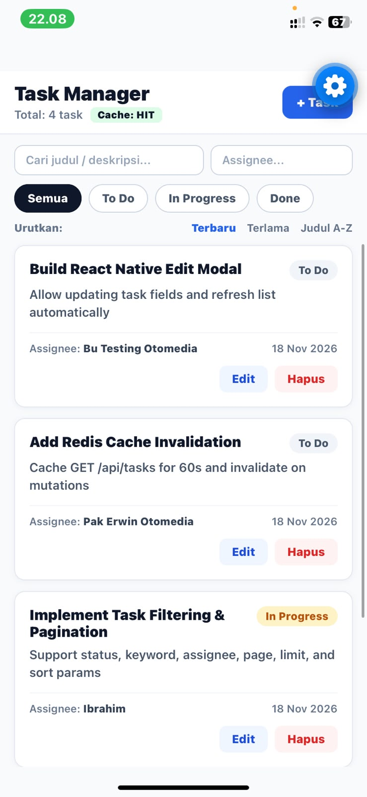
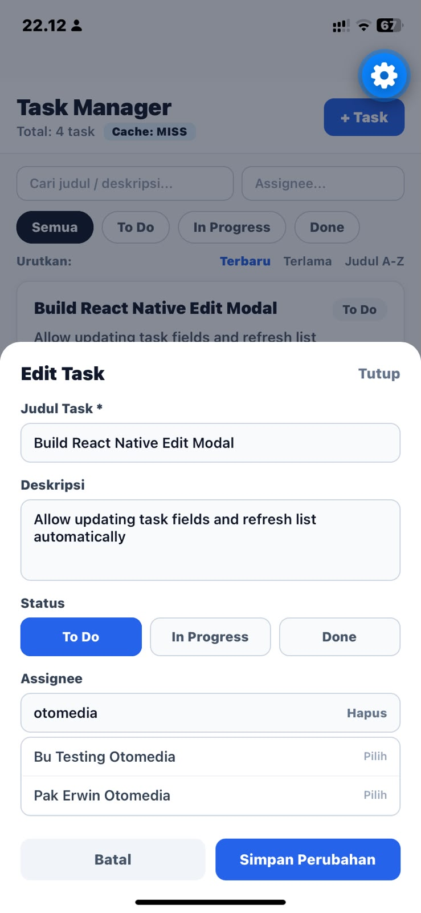
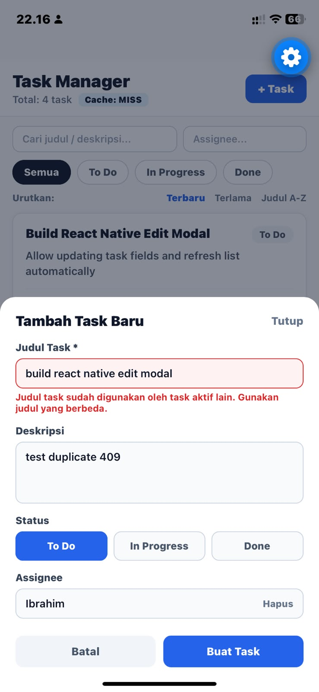
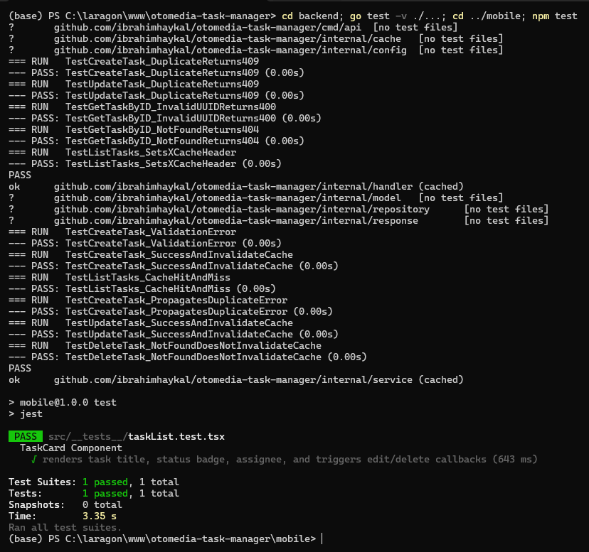

# Task Management App - Fullstack Assessment

Aplikasi manajemen tugas (_Task Manager_) full-stack menggunakan **Go (Gin)**, **MySQL**, **Redis**, dan **React Native (Expo + TypeScript)**.

## Tech Stack

- **Backend:** Go (Gin), MySQL 8.0, Redis 7
- **Frontend:** React Native (Expo SDK 58), TypeScript
- **Testing:** Go `testing` + `httptest`, Jest + `@testing-library/react-native`

---

## Cara Menjalankan

### 1. Jalankan MySQL & Redis (Docker)

```bash
docker compose up -d
```

_Database, tabel `tasks`, dan data awal otomatis dibuat dari `backend/migrations/001_create_tasks_table.sql`._

### 2. Jalankan Backend API

```bash
cd backend
cp .env.example .env
go run cmd/api/main.go
```

Berjalan di `http://localhost:8080`.

### 3. Jalankan Frontend Mobile

```bash
cd mobile
npm install
npx expo start
```

Scan QR code via aplikasi **Expo Go** (pastikan HP & laptop di jaringan Wi-Fi yang sama).

---

## Menjalankan Unit Tests

```bash
# Backend (Update, Search, Cache Invalidation, & 409 Handling)
cd backend && go test -v ./...

# Frontend (TaskCard Component)
cd mobile && npm test
```

---

## API Endpoints

| Method   | Endpoint         | Keterangan                                                                                                                     |
| :------- | :--------------- | :----------------------------------------------------------------------------------------------------------------------------- |
| `GET`    | `/api/tasks`     | List task aktif. Query params: `status`, `keyword`, `assignee`, `page`, `limit`, `sort`. Header `X-Cache: HIT/MISS` (TTL 60s). |
| `GET`    | `/api/tasks/:id` | Detail task berdasarkan UUID.                                                                                                  |
| `POST`   | `/api/tasks`     | Tambah task baru & invalidate cache (`409` jika judul aktif duplikat).                                                         |
| `PUT`    | `/api/tasks/:id` | Update task & invalidate cache (`409` jika judul aktif duplikat).                                                              |
| `DELETE` | `/api/tasks/:id` | _Soft delete_ (`deleted_at = NOW()`) & invalidate cache.                                                                       |

<details>
<summary><b>Contoh Response JSON (Success & 409 Error)</b></summary>

**Success (`200 OK`)**

```json
{
  "success": true,
  "message": "Tasks retrieved successfully",
  "data": {
    "tasks": [
      {
        "id": "11111111-1111-4111-8111-111111111101",
        "title": "Setup Go Gin Boilerplate",
        "description": "Initialize project structure, database connection, and Redis client",
        "status": "done",
        "assignee": "Ibrahim",
        "created_at": "2026-11-18T10:00:00Z",
        "updated_at": "2026-11-18T10:00:00Z"
      }
    ],
    "pagination": { "page": 1, "limit": 10, "total_items": 4, "total_pages": 1 }
  }
}
```

**Duplicate Title (`409 Conflict`)**

```json
{
  "success": false,
  "error": {
    "code": "DUPLICATE_TITLE",
    "message": "task with the same title already exists"
  }
}
```

</details>

---

## Highlights Arsitektur

- **Unique Active Title + Soft Delete:** Menggunakan _generated column_ `active_title` (`IF(deleted_at IS NULL, title, NULL)`) berindeks `UNIQUE` di MySQL agar judul task aktif tetap unik (`409 Conflict`), sementara judul dari task yang sudah di-soft-delete bisa dipakai ulang.
- **Redis Query-Aware Cache:** Key cache mencakup seluruh parameter filter (`tasks:list:...`) dengan TTL 60 detik dan di-invalidate menggunakan `SCAN` non-blocking setiap kali terjadi `POST`, `PUT`, atau `DELETE`.
- **Safe Dynamic Sorting:** Validasi _whitelist_ kolom `ORDER BY` di repository untuk mencegah _SQL Injection_.

---

## Screenshots

<table>
  <tr>
    <th width="25%">Task List &amp; Redis Cache</th>
    <th width="25%">Form &amp; Assignee Autocomplete</th>
    <th width="25%">Duplicate Title (<code>409</code>)</th>
    <th width="25%">Unit Tests</th>
  </tr>
  <tr>
    <td width="25%"></td>
    <td width="25%"></td>
    <td width="25%"></td>
    <td width="25%"></td>
  </tr>
</table>
